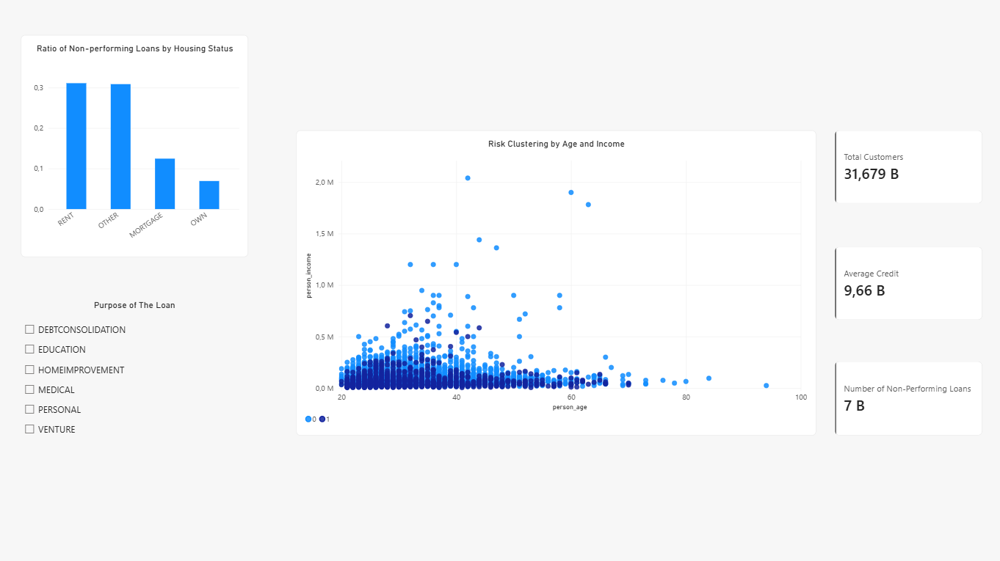

# 🏦 Individual Credit Risk and Customer Segmentation Analysis (End-to-End Data Analysis)

## 📌 Project Overview

This project is an **end-to-end data analytics** study conducted to optimize the credit risk management of a financial institution (or bank). The main objective is to predict the **credit default risk** by examining the demographic and financial backgrounds of customers, and to provide an interactive reporting dashboard that enables data-driven decision-making for bank executives.

The most prominent feature of this project is the construction of a complete data pipeline: raw data was extracted from Excel, cleaned with Python, transferred to a relational database using SQLite, queried via SQL, and finally visualized with Power BI.

## 🛠️ Technologies and Tools Used

* **Data Recognition & Profiling:** Microsoft Excel (Creating a Data Dictionary, anomaly detection)
* **Data Cleaning & EDA:** Python (Pandas, Matplotlib, Seaborn)
* **Database Management & Querying:** SQLite & SQL
* **Business Intelligence & Visualization (BI):** Power BI (Interactive Executive Dashboard)

## 🚀 Project Workflow

### Phase 1: Data Profiling (Excel)
* Examined the raw `credit_risk_dataset.csv` file obtained from Kaggle.
* Created a **Data Dictionary** detailing data types and column meanings.
* Identified data entry errors (fat-finger errors) such as 144 years of age and 123 years of employment length.

### Phase 2: Data Cleaning and Exploratory Data Analysis (Python)
* **Outlier Handling:** Filtered out illogical age (>100) and employment length (>60) records identified in Excel.
* **Missing Value Imputation:** To avoid skewing the mean in financial data, null values in interest rates (`loan_int_rate`) and employment lengths were filled with the **median** value.
* **Encoding & Format Solutions:** Resolved "Encoding (UTF-8 / Latin-1)" issues and the automatic conversion of interest rates to dates (e.g., Nov.14) caused by Excel during CSV saves. These data corruption issues were fixed at the Python level by preserving the raw data.

### Phase 3: Calculation of Risk Metrics (SQL)
* Transferred the cleaned data to an SQLite database (`credit_risk.db`).
* Wrote SQL queries to solve the business problem, calculating default rates across various demographic breakdowns (e.g., risk analysis based on home ownership status).

### Phase 4: Executive Dashboard Design (Power BI)
* Created fundamental KPI cards for executives such as "Total Customers, Average Loan Amount, Total Defaulted Loans".
* Designed Age/Income scatter plots to observe customer risk clustering.
* Added interactive filters (Slicers) based on "Loan Intent" (Education, Medical, etc.) to make the dashboard dynamic.

**Dashboard Snapshot:**

## 📊 Key Business Insights

1. **Home Ownership and Risk Relationship:** According to SQL analyses and Power BI visualizations, the probability of default for renting customers (RENT) is statistically higher compared to homeowners (OWN) or those with mortgages (MORTGAGE). The bank should tighten its scoring criteria when granting loans to renters.
2. **Clustering in Income Segmentation:** Scatter Plot analysis reveals that the vast majority of defaulted customers (Red Dots) are clustered in the low-to-middle income level. In higher income groups, the default rate drops dramatically, regardless of the loan amount.

## 💻 How to Run the Project Locally

1. Clone the repository: `git clone https://github.com/YOUR_USERNAME/credit-risk-analysis.git`
2. Install the required Python libraries: `pip install pandas matplotlib seaborn sqlite3`
3. Run the `main.py` file for the data cleaning step.
4. Run the `sql_analizi.py` file for SQL analytics and database creation.
5. Open the `Dashboard.pbix` (if available) file with Power BI to review the results.

